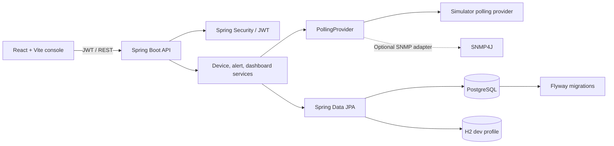
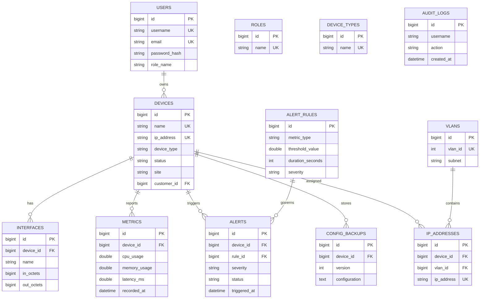
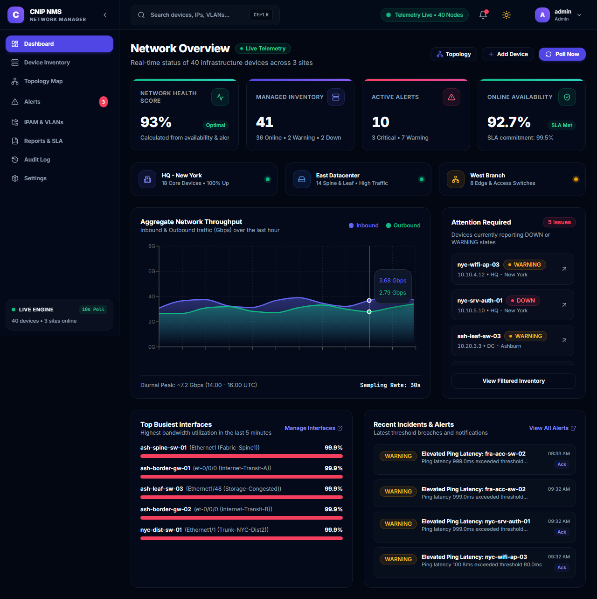
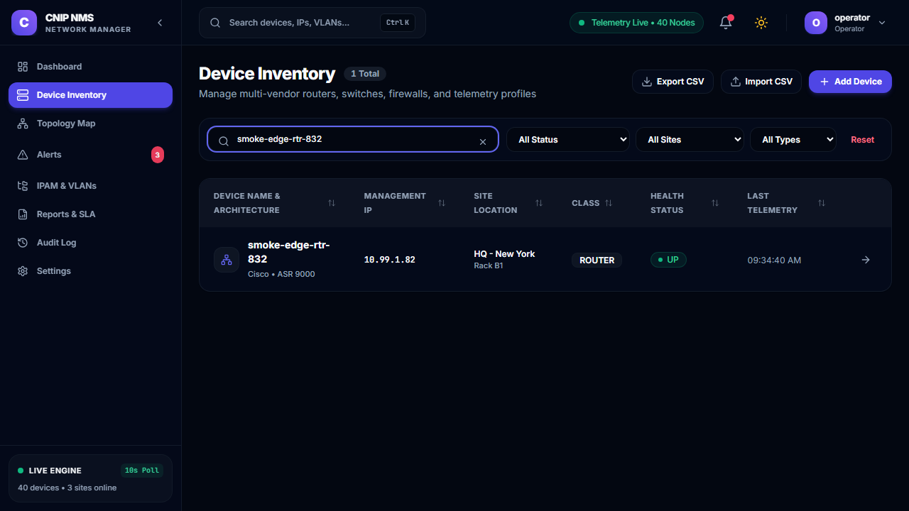
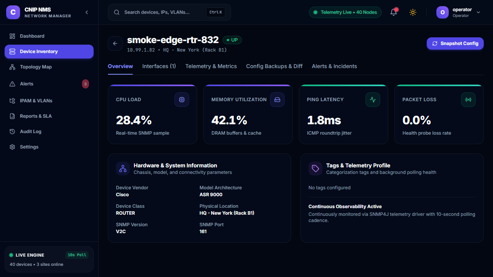
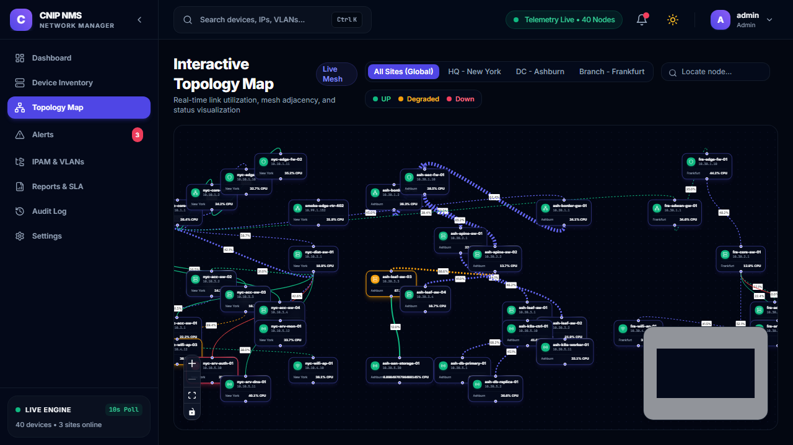
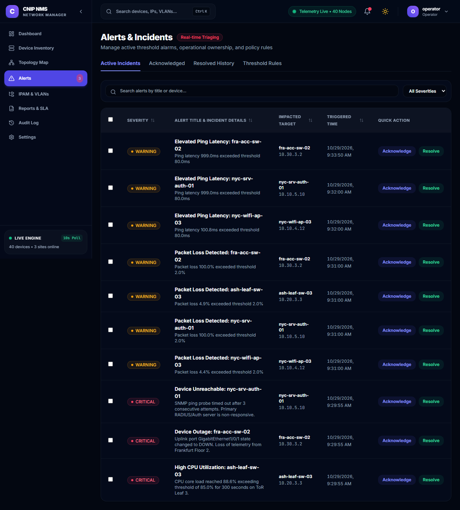
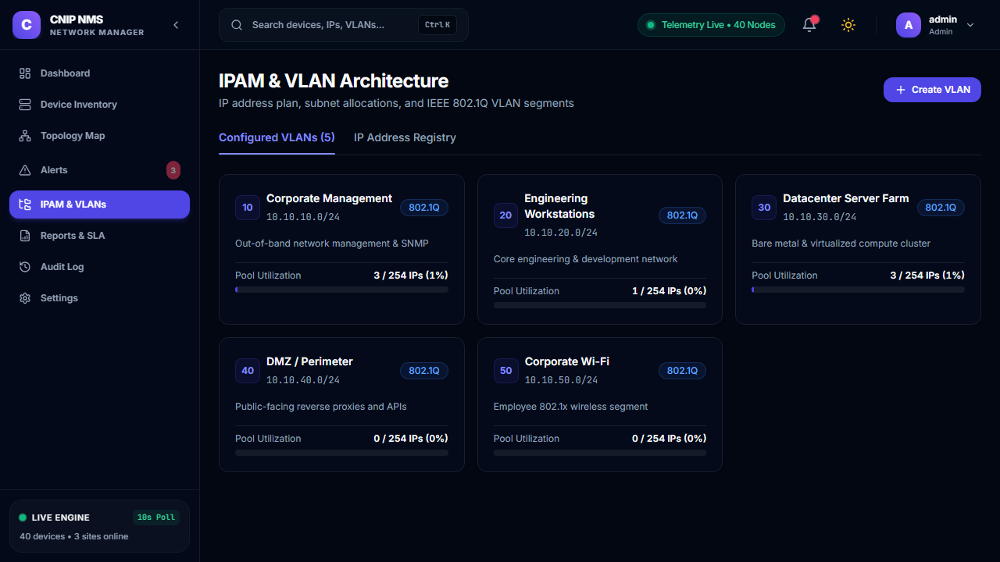
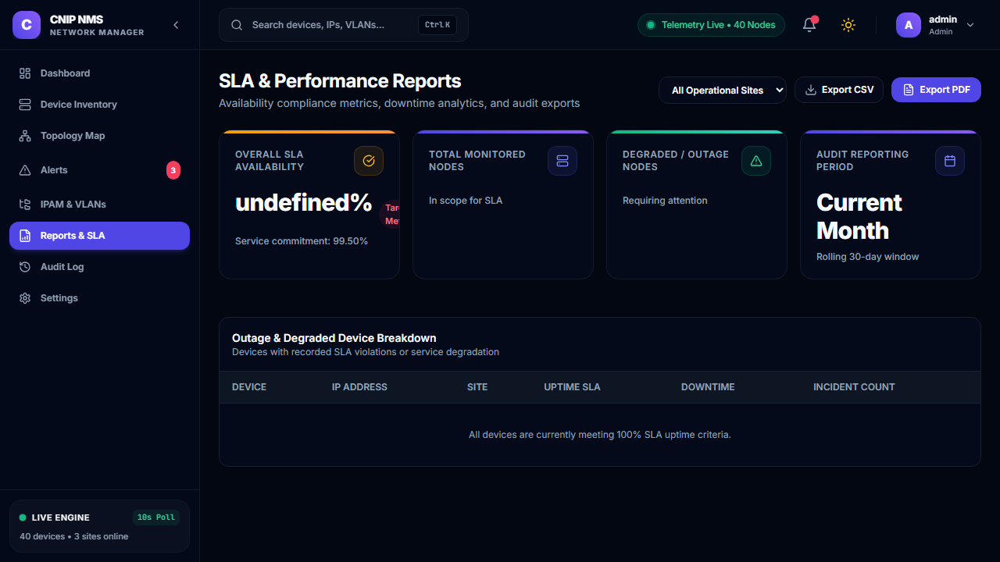
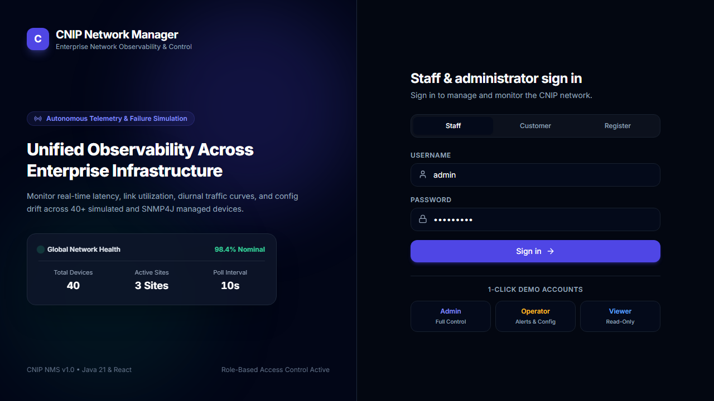

# CNIP Network Manager

CNIP Network Manager is a demo-ready network operations console built with Java 21, Spring Boot, PostgreSQL, React, and TypeScript. It ships with a simulator so the dashboard is useful without physical networking equipment.

## Run the demo

### Docker Compose (recommended)

Install Docker Desktop, then from this directory run:

```powershell
docker compose up --build
```

The local demo uses development-only defaults so the stack starts without additional configuration. For a custom deployment, copy `.env.example` to `.env` and set a unique base64-encoded `JWT_SECRET`, plus database credentials. Do not use the example values outside a local demo.

On Windows PowerShell, create and edit the environment file with:

```powershell
Copy-Item .env.example .env
notepad .env
```

In `.env`, replace the `JWT_SECRET` and `POSTGRES_PASSWORD` values with private values. `.env.example` is only a template; do not type its filename by itself as a command.

Open the console at [http://localhost:5173](http://localhost:5173). The backend API is at [http://localhost:8080](http://localhost:8080); interactive OpenAPI docs are at [http://localhost:8080/swagger-ui.html](http://localhost:8080/swagger-ui.html).

### Deploy on a Linux server

Install Docker Engine and the Docker Compose plugin, copy the project to the server, then create a private `.env` file:

```bash
cp .env.example .env
openssl rand -base64 48
# Put the generated value in JWT_SECRET; also replace POSTGRES_PASSWORD.
docker compose up --build -d
docker compose ps
```

Allow inbound TCP port `5173` in the server firewall and browse to `http://SERVER_IP:5173`. For an internet-facing deployment, put a TLS reverse proxy (for example, Caddy or Nginx) in front of the frontend and restrict direct access to backend port `8080` and database port `5432`; configure TLS, backups, and monitoring before production use.

### Run the backend and frontend separately

Requirements: Java 21+, Maven 3.9+, Node 20+, and PostgreSQL (or use the H2 dev profile).

```powershell
# Backend, using the default H2 dev profile
cd backend
$env:JWT_SECRET = "Y25pcC1kZW1vLWtleS1wbGVhc2UtcmVwbGFjZS1mb3ItcHJvZHVjdGlvbi0xMjM0NTY="
mvn spring-boot:run

# In a second terminal
cd frontend
npm install
npm run dev
```

For PostgreSQL, set `SPRING_PROFILES_ACTIVE=prod`, `SPRING_DATASOURCE_URL`, `SPRING_DATASOURCE_USERNAME`, and `SPRING_DATASOURCE_PASSWORD` before starting the backend. Flyway applies the schema at startup. The simulator is enabled by default; set `SIMULATOR_ENABLED=false` to turn it off.

## Demo accounts

| Role | Username | Password |
|---|---|---|
| Admin | `admin` | `Admin123!` |
| Operator | `operator` | `Operator123!` |
| Viewer | `viewer` | `Viewer123!` |

These are local demonstration staff accounts stored in the database with BCrypt password hashes. Customers can choose **Register as customer** on the login screen to create a customer-only account. An administrator can assign any inventory device to a customer from the device detail page; customer accounts get a private dashboard with status, latest CPU/memory utilization and latency, plus alerts for only their assigned devices. Customer accounts cannot access staff-wide inventory, topology, configuration, reports, audit, or settings APIs.

The bootstrap process creates or refreshes the three demo staff identities at startup; change them and use managed account provisioning before production. Login successes and failures, customer registrations, and administrator device assignments are recorded in the audit log.

## Architecture



The API is organized as controller → service → repository for inventory workflows, with monitoring executed on a scheduled worker so requests remain independent of polling. The simulator seeds 40 devices across North Campus, Central Hub, and Harbor Point, then records metrics every 10 seconds, varies traffic with a daily curve, and introduces occasional CPU spikes and outages. Metric retention defaults to seven days.

## Data model



Flyway creates the normalized schema and indexes device IP/status and metric time-series lookups. Customer accounts are stored in the same users table with the `CUSTOMER` role, and `devices.customer_id` records optional device ownership.

## API overview

All endpoints except login, customer registration, health, and API documentation require a bearer JWT.

| Method | Endpoint | Purpose |
|---|---|---|
| `POST` | `/api/auth/login` | Authenticate and issue JWT (`username`, `password`) |
| `POST` | `/api/auth/register` | Register a customer account and issue a JWT |
| `GET` | `/api/auth/customers` | List customer accounts for Admin device assignment |
| `GET` | `/api/dashboard/summary` | Device counts, health score, traffic, busiest devices, alerts |
| `GET` | `/api/devices?search=&site=&deviceType=&status=&page=&size=&sortBy=&sortDir=` | Filtered, sorted, paginated inventory |
| `POST`, `PUT` | `/api/devices`, `/api/devices/{id}` | Create or update a device (Admin / Operator) |
| `PUT` | `/api/devices/{id}/customer` | Assign or unassign a device (Admin only) |
| `DELETE` | `/api/devices/{id}` | Delete a device (Admin only) |
| `GET` | `/api/devices/export/csv` | Download inventory CSV |
| `POST` | `/api/devices/import/csv` | Import multipart CSV file (Admin / Operator) |
| `GET` | `/api/dashboard/summary` | Health, device counts, traffic, busiest interfaces, alerts |
| `GET` | `/api/monitoring/devices/{id}/metrics?hours=24` | Device time-series metrics |
| `GET` | `/api/alerts?status=&severity=&deviceId=&search=&page=&size=` | Paginated alert history |
| `POST` | `/api/alerts/action` | Acknowledge or resolve alerts by ID (Admin / Operator) |
| `GET` | `/api/topology?site=` | React Flow topology nodes and links |
| `GET`, `POST` | `/api/ipam/vlans`, `/api/ipam/ips` | VLANs, IP inventory, allocations (Admin for writes) |
| `GET`, `POST` | `/api/configs/devices/{id}` | Configuration backup history and snapshot (Operator / Admin) |
| `GET` | `/api/audit-logs?page=&size=` | User/system audit history |
| `GET` | `/api/reports/summary` | SLA and performance report summary |
| `GET` | `/api/reports/export/csv`, `/api/reports/export/pdf` | Download report exports |
| `GET`, `PUT` | `/api/settings/notifications` | Email/webhook notification settings (Admin for writes) |
| `GET` | `/api/customer/devices`, `/api/customer/alerts` | Customer-only assigned devices and alert history |

OpenAPI JSON is served at `/api-docs`.

## Tests

```powershell
cd backend
mvn test

cd ..\frontend
npm run build
npx playwright install chromium
npx playwright test
```

The Playwright smoke suite covers login/dashboard, adding a device, and acknowledging an alert. Testcontainers dependencies are included for PostgreSQL-backed integration coverage; Docker is required to run container-backed tests.

## Screenshots

The app is designed responsively for desktop and mobile, with light/dark themes. The Playwright smoke suite writes browser screenshots for its three verified flows:


















## Current demo boundaries

- The simulator drives CPU, memory, latency, throughput, status changes, and alert-rule evaluation. SNMP4J support is available behind the polling service interface; the simulator is selected by default.
- Demo users are database-backed, but their default passwords are reset during bootstrap. Replace the demo account lifecycle before production use.
- Email/webhook delivery requires valid deployment-specific channel configuration and credentials. Do not use the example URLs or passwords in production.
- Docker Compose is the intended one-command local environment. Docker is needed to validate that stack; it was not available in the authoring environment.
